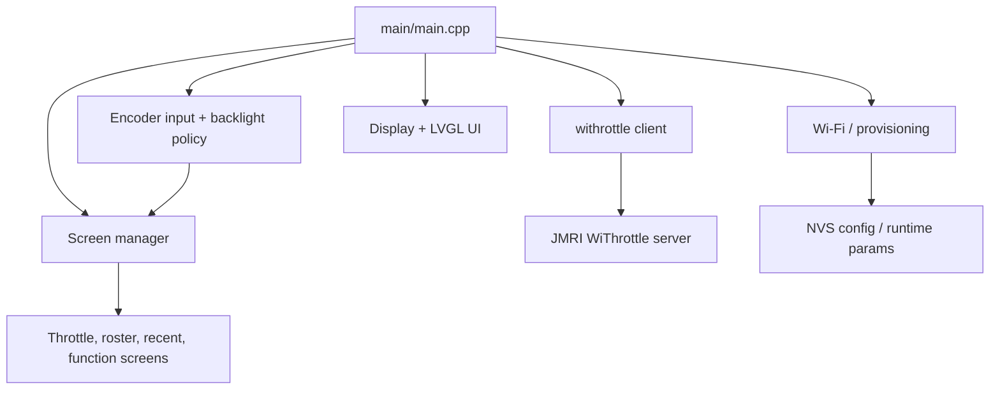

# Code documentation

This folder contains developer-facing documentation for the application logic, runtime flow, and module boundaries of the WiThrottle dial firmware.

## Purpose

This project is an ESP-IDF firmware for the Waveshare ESP32-S3 Knob. It connects to a JMRI WiThrottle server, presents a roster-driven UI, and exposes controls for driving a locomotive, toggling functions, and handling connectivity/OTA provisioning.

The design centers on a few clear responsibilities:

- UI and screen orchestration
- Wi-Fi and JMRI discovery
- WiThrottle protocol client behavior
- Storage and configuration state
- Hardware input and battery handling

## Entry point

The firmware starts in [main/main.cpp](../../main/main.cpp). The app bootstrap sequence is:

1. Initialize console commands and parameter storage.
2. Bring up Wi-Fi.
3. Initialize battery sensing.
4. Start the WiThrottle client.
5. Initialize the display and generated LVGL UI.
6. Enter the periodic UI pump and encoder input loops.

The runtime loop is organized around a LVGL lock to keep the UI and input system consistent while the screen manager consumes encoder events and UI updates.

## High-level architecture

## Primary code areas

| Area | Role | Key entry points |
|---|---|---|
| [main](../../main) | Application startup, UI tick loop, encoder task | [main.cpp](../../main/main.cpp) |
| [src](../../src) | Runtime config templates and secrets | [secrets.h.example](../../src/secrets.h.example) |
| [components/ui](../../components/ui) | LVGL display platform setup and generated UI | generated screen code |
| [components/ui_screens](../../components/ui_screens) | Screen lifecycle and active-screen state | `screen_mgr.*` |
| [components/withrottle_client](../../components/withrottle_client) | Client logic for JMRI commands and state | `withrottle_client.*` |
| [components/wifi](../../components/wifi) | Wi-Fi station setup and network state | `wifi.*` |
| [components/param](../../components/param) | NVS-backed runtime parameter API | `Param.*` |
| [components/netprov](../../components/netprov) | SoftAP provisioning and validation logic | provisioning logic |
| [components/jmri_discovery](../../components/jmri_discovery) | JMRI service discovery | discovery chooser |
| [components/loco_ref](../../components/loco_ref) | Locomotive address and value parsing | pure logic tests |
| [components/horn_resolver](../../components/horn_resolver) | Horn function selection | pure logic tests |
| [components/recents](../../components/recents) | Recent locomotive persistence | NVS + serialization |
| [components/ota_server](../../components/ota_server) | OTA update server | `ota_server.*` |
| [test](../../test) | Native test suites | Unity tests |

## Runtime flow

### 1. Startup and hardware init

The firmware initializes the console, Wi-Fi, battery sensor, and display before the UI is built. The app intentionally starts the WiThrottle client early because the protocol client and LVGL stack contend for limited internal RAM.

### 2. UI initialization

The display is initialized, and a generated LVGL scene is built under the LVGL lock to avoid working while the render task is still partially configured. After startup, a periodic task updates the current screen and consumes input activity.

### 3. Encoder and UI synchronization

The encoder task reads rotational events and accumulates scroll deltas. The UI task then consumes those events under a lock, allowing screen rotation and interaction to remain predictable even when the backlight is asleep.

### 4. WiThrottle operation

The connection to JMRI is handled through the WiThrottle client and associated server discovery components. The UI builds a roster and recent-loco model from server data, then drives throttle state, direction, function toggles, horn control, and emergency stop commands.

### 5. Persistence and recovery

The app stores preferences in NVS using the parameter system, keeps recent locomotives across reboots, and can recover gracefully if a Wi-Fi or JMRI session drops. The app falls back to a connecting-state flow and automatically returns when the connection is restored.

## Build and test workflow

For the project build and verification steps, see the top-level [README.md](../../README.md). In short:

- Build with `./build.sh build`
- Flash with `./build.sh flash monitor`
- Run native logic tests with `bash test/native/run.sh`

## Recommended reading order

For a new developer, the best order is:

1. [main/main.cpp](../../main/main.cpp)
2. [README.md](../../README.md)
3. [ui-guide.md](ui-guide.md)
4. [ui-controls.md](ui-controls.md)
5. [debugging.md](debugging.md)
6. [troubleshooting.md](troubleshooting.md)
7. [components/ui_screens](../../components/ui_screens)
8. [components/withrottle_client](../../components/withrottle_client)
9. [components/wifi](../../components/wifi)
10. [components/param](../../components/param)
11. [components/recents](../../components/recents)
12. [components/netprov](../../components/netprov)

This sequence follows the app from startup → UI → connection → persistence → provisioning.
