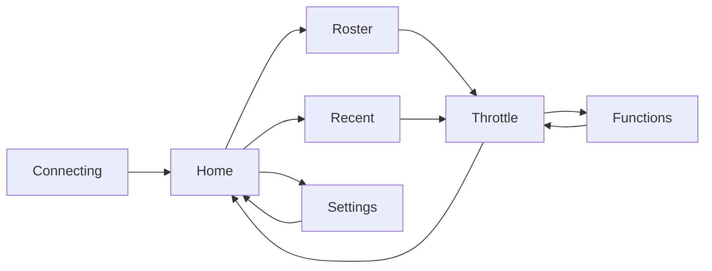

# UI controls cheat sheet

This page summarises the practical controls used across the firmware. It complements the screen-by-screen guide and focuses on how the user interacts with the hardware and each screen.

## Rotating encoder

The rotary encoder is the primary input device.

Use:
- Scroll through roster and recent lists
- Move the focus highlight on function rows
- Change locomotive speed on the throttle screen
- Adjust the speed arc position while driving

Behavior:
- Each detent produces a delta that is accumulated in the input task.
- The current screen consumes the scroll event under the LVGL lock.
- In the Throttle screen, the rotation value updates the circular arc and sends the new speed to JMRI.

## Touch / tap

Touch input is used for all button presses on the round display.

Common actions:
- Tap a roster or recent row to acquire a locomotive
- Tap the FN button to open the function list
- Tap the STOP button to trigger an emergency stop
- Tap the back/home button to return to Home or release a loco

## Home / back actions

The Home symbol is used consistently as the exit/back action when leaving a context.

Examples:
- Roster → Home
- Recent → Home
- Throttle → Home (releases current loco)
- Functions → Throttle
- Settings → Home

This makes the UI predictable and keeps the root menu reachable from almost any screen.

## Throttle screen controls

The Throttle screen is the main driving surface.

| Control | Action |
|---|---|
| Encoder | Change speed / move arc |
| STOP button | Emergency stop |
| FN button | Open function screen |
| HORN button | Hold to sound horn; release to stop |
| Back/Home button | Release loco and return to Home |
| Direction label | Shows F / R |
| Battery label | Shows battery state and percentage |

Notes:
- The horn button is a press/release control; the signal is sent while the button is held.
- The speed readout is derived from the arc position and the JMRI-reported speed state.
- If connectivity drops, the app automatically falls back to the Connecting screen.

## Function screen controls

The Function screen centers on the loco’s named functions.

| Control | Action |
|---|---|
| Encoder | Move through function rows |
| Function row | Toggle the related function state |
| Back button | Return to the throttle |

Notes:
- The list is refreshed periodically so button colours reflect the latest JMRI function state.
- Hidden or unused rows are reused instead of recreated unnecessarily for stability.

## Menu screens

Home, Roster, Recent, and Settings all follow a simple menu style.

### Home
- Roster: browse and select a loco
- Recent: revisit recent locos
- Settings: view config and reconfigure Wi-Fi

### Roster
- Scroll through roster entries
- Tap a row to acquire and drive a loco

### Recent
- Scroll through recently used locos
- Select a loco to reacquire it quickly

### Settings
- View current Wi-Fi SSID and IP
- View current JMRI server URL
- Trigger reconfiguration flow for Wi‑Fi setup

## Status indicators

### Battery
The app shows a battery icon and percentage in multiple screens.

Examples:
- battery full / 3/2/1 / empty symbols
- charging indicator when the device is powered while charging

### Connection state
The app shows dynamic status messages on the Connecting screen:
- Wi‑Fi connecting
- JMRI connecting
- roster loading
- ready

## Typical user journeys

### Start a locomotive
1. Wait for the device to connect.
2. Open Home.
3. Select Roster or Recent.
4. Choose a loco.
5. Drive on the Throttle screen.

### Emergency stop
1. Tap the red STOP button.
2. The app sends the stop command immediately.
3. The arc turns to a red emergency state.

### Toggle locomotive functions
1. Open FN on the throttle.
2. Scroll to the function row.
3. Tap the row to toggle it.
4. Return to the throttle with the back button.

## Navigation map

## Implementation notes

The control behavior is implemented by the screen modules and the screen manager:

- [components/ui_screens/include/screen_mgr.h](../../components/ui_screens/include/screen_mgr.h)
- [components/ui_screens/screen_home.cpp](../../components/ui_screens/screen_home.cpp)
- [components/ui_screens/screen_roster.cpp](../../components/ui_screens/screen_roster.cpp)
- [components/ui_screens/screen_throttle.cpp](../../components/ui_screens/screen_throttle.cpp)
- [components/ui_screens/screen_functions.cpp](../../components/ui_screens/screen_functions.cpp)
- [components/ui_screens/screen_settings.cpp](../../components/ui_screens/screen_settings.cpp)

This is the practical reference for using the device day to day, while the screen guide explains each page in more detail.
