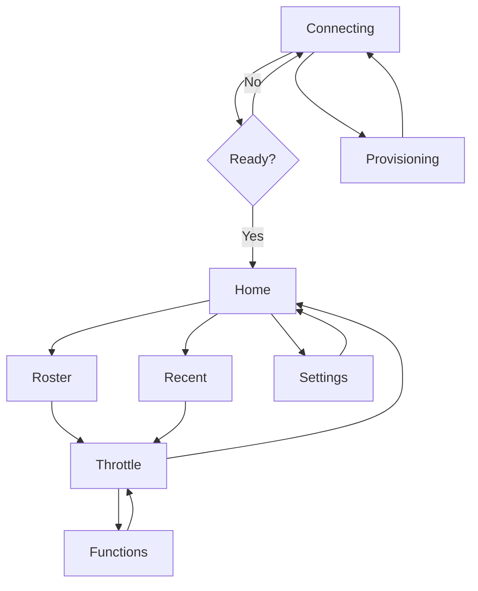

# Screen-by-screen UI guide

This guide explains the visible screens in the firmware and how the user moves between them. It follows the actual runtime flow in the screen manager and the generated LVGL UI.

## Screen flow summary

## 1. Connecting

Purpose:
- Boot-time status screen while the device establishes Wi-Fi, finds the JMRI server, and loads the roster.

What the user sees:
- A spinner animation in the center
- A status label such as:
  - “Connecting Wi-Fi...”
  - “Connecting to JMRI...”
  - “Loading roster...”

Behavior:
- If Wi-Fi is missing or association times out, the app can launch provisioning.
- If a valid JMRI server is found and the session becomes ready, it automatically goes to Home or back to Throttle depending on whether a loco was previously active.

Navigation:
- Automatic only; there is no user selection here.

Relevant code:
- [components/ui_screens/screen_connecting.cpp](../../components/ui_screens/screen_connecting.cpp)

## 2. Home

Purpose:
- Main menu after a successful connection.

Controls:
- Three large menu buttons arranged vertically:
  - Roster
  - Recent
  - Settings
- Battery indicator in the upper area

Behavior:
- Roster opens the roster list
- Recent opens the most recently used locos
- Settings opens configuration details and the reconfigure button

Navigation:
- Roster → select a loco → Throttle
- Recent → select a loco → Throttle
- Settings → back to Home

Relevant code:
- [components/ui_screens/screen_home.cpp](../../components/ui_screens/screen_home.cpp)

## 3. Roster

Purpose:
- Browse roster entries from JMRI and select a locomotive.

Controls:
- Top bar with a Home button and title “Roster”
- Scrollable vertical list of roster names
- Encoder rotates to move focus through the list
- Click or tap on a roster row to acquire the loco

Behavior:
- The list is rebuilt when the roster size changes
- Selecting a loco calls `withr::acquire_loco()` and pushes it into the recents list
- The app then opens the throttle screen

Navigation:
- Home → Roster
- Roster → Throttle
- Back/Home → Home

Relevant code:
- [components/ui_screens/screen_roster.cpp](../../components/ui_screens/screen_roster.cpp)

## 4. Recent

Purpose:
- Jump back to locomotives the user has driven before.

Controls:
- Top bar with a Home button and title “Recent”
- Scrollable list of recent locomotives
- Encoder movement changes focus
- Tap a row to reacquire the loco

Behavior:
- Recents are loaded from NVS-backed storage and serialized as a compact state signature
- The list is only rebuilt when the recents state changes

Navigation:
- Home → Recent
- Recent → Throttle
- Back/Home → Home

Relevant code:
- [components/ui_screens/screen_recent.cpp](../../components/ui_screens/screen_recent.cpp)

## 5. Throttle

Purpose:
- The main driving screen; the user controls speed, direction, horn, stop, and function list.

Controls:
- Circular speed arc with a value readout
- Direction label: F or R
- Loco name at the top
- Battery indicator in the top-right area
- Large red STOP button on the left
- Green FN button on the right
- Center blue HORN button
- Home/back button in the top-left area

Behavior:
- The encoder changes the speed arc position
- The arc value is converted to a percentage and sent to JMRI
- The app keeps the display synced with the reported JMRI speed while the user is not actively driving
- Pressing the HORN button sends horn on/off state
- Back/releases the loco and returns to Home
- Fn opens the function list

Notes:
- If Wi-Fi or JMRI connectivity drops, this screen falls back to the Connecting screen.
- The arc and speed display are intentionally updated carefully to avoid snapping back to stale values while the user is actively steering the dial.

Navigation:
- Roster or Recent → Throttle
- Throttle → Functions
- Throttle → Home (on back/release)

Relevant code:
- [components/ui_screens/screen_throttle.cpp](../../components/ui_screens/screen_throttle.cpp)

## 6. Functions

Purpose:
- Toggle named locomotive functions as provided by JMRI.

Controls:
- Fixed title bar with a back button to return to Throttle
- Scrollable function list
- Encoder scrolls through available function rows
- Tapping a function row toggles it

Behavior:
- Function rows are built once and refreshed periodically
- Active rows track JMRI state so the UI reflects the current function values
- The list is kept in sync with the loco’s function labels and enabled states

Navigation:
- Throttle → Functions
- Functions → Throttle

Relevant code:
- [components/ui_screens/screen_functions.cpp](../../components/ui_screens/screen_functions.cpp)

## 7. Settings

Purpose:
- Display current network status and allow reconfiguration.

Controls:
- Back/Home button
- Wi-Fi SSID value
- Current IP address
- Current JMRI server URL
- “Reconfigure Wi-Fi” button

Behavior:
- Live labels are updated from the Wi-Fi and client state
- Reconfigure Wi-Fi opens the provisioning flow and switches the device into setup mode

Navigation:
- Home → Settings
- Settings → Home

Relevant code:
- [components/ui_screens/screen_settings.cpp](../../components/ui_screens/screen_settings.cpp)

## 8. Provisioning

Purpose:
- On-device Wi-Fi and JMRI setup flow when credentials are missing or a Wi-Fi association fails.

Controls:
- The app takes the device into a SoftAP setup mode named “WiThrottle-Setup”
- The user connects from a phone and configures Wi-Fi and JMRI values through the captive portal

Behavior:
- Device enters provisioning automatically in setup scenarios
- The portal validates the settings and saves them to NVS
- After a successful save, the device transitions back into normal connection flow

Navigation:
- Entered automatically from Connecting or Settings
- Returned to normal connection flow after configuration

Relevant code:
- [components/netprov](../../components/netprov)
- [components/ui_screens/screen_connecting.cpp](../../components/ui_screens/screen_connecting.cpp)

## 9. Splash / startup state

Purpose:
- Transitional state during the earliest boot phase.

In this codebase, the screen manager includes a splash screen enum, but the main app flow quickly moves into Connecting and then into the menu state. It is not the primary day-to-day user interface.

## UI conventions used across the app

- Home button symbols are used for navigation back to the root menu
- The rotary encoder is the primary selector and speed control
- The app keeps UI state in sync with network state and only rebuilds list widgets when necessary
- Battery, network, and loco state are refreshed in a lightweight periodic loop

## Best way to explore the UI in code

If you want to change UI behavior, start here:

1. [components/ui_screens/include/screen_mgr.h](../../components/ui_screens/include/screen_mgr.h)
2. [components/ui_screens/screen_connecting.cpp](../../components/ui_screens/screen_connecting.cpp)
3. [components/ui_screens/screen_home.cpp](../../components/ui_screens/screen_home.cpp)
4. [components/ui_screens/screen_roster.cpp](../../components/ui_screens/screen_roster.cpp)
5. [components/ui_screens/screen_throttle.cpp](../../components/ui_screens/screen_throttle.cpp)
6. [components/ui_screens/screen_functions.cpp](../../components/ui_screens/screen_functions.cpp)
7. [components/ui_screens/screen_settings.cpp](../../components/ui_screens/screen_settings.cpp)

This gives a direct path from app state transitions to the screen implementation that owns each view.
